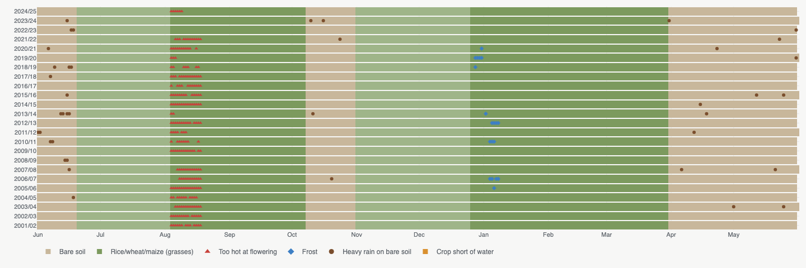

# basalt: a stress test for crop rotations

Explore how your current rotation and up to three alternatives would have done through 24 seasons of NASA weather.

[Public app](https://basalt-nasa.streamlit.app/) · [Slides](https://basalt-nasa.streamlit.app/?view=slides)



## What it does

- Starts with a field pin or eight offline demo fields across six continents.
- Uses regional crop calendars to help you confirm what grows and when. Satellite greenness helps check crop dates where it is available.
- Replays 2001 to 2024, comparing soil practices, crop water use and weather risks season by season.
- Shows crop cover, bare soil and weather events in Season Strata.
- Shows the validation results and assumptions behind each option, with questions to check locally.

Runs for any cultivated region covered by the global datasets. Calibrated in Punjab (with Punjab Agricultural University guidance); global defaults elsewhere, with the accuracy cost measured and confidence always shown.

## Run locally

Use Python 3.11.

```sh
python3.11 -m pip install -r requirements.txt
python3.11 -m streamlit run app.py
```

Choose any demo from the landing page, or open the [Ludhiana](http://localhost:8501/?site=ludhiana), [Jaipur](http://localhost:8501/?site=jaipur), or [Central Malawi](http://localhost:8501/?site=malawi) demo directly. Each opens a prepared replay. Applying a climate scenario replays the same local weather file with the selected changes.

## Why these demo fields

The pins represent cultivated land near each named city. Each demo uses a representative model scenario based on local crop calendars, water sources and historical NASA POWER weather. The six added field pins were checked against [ESA WorldCover](https://esa-worldcover.org/en/data-access).

| Demo field | Why it is in the set |
| --- | --- |
| [Ludhiana, India](https://basalt-nasa.streamlit.app/?site=ludhiana) | Irrigated rice and wheat show how replacing ponded rice can change pumping demand. [Punjab Agricultural University](https://pau.edu/content/ccil/pf/pp_kharif.pdf) |
| [Lilongwe plain, Malawi](https://basalt-nasa.streamlit.app/?site=malawi) | Rainfed maize provides a comparison with legumes and dry-season cover in a system that relies on one rainy season. [GGCMI Phase 3](https://zenodo.org/records/5062513) |
| [Jaipur, India](https://basalt-nasa.streamlit.app/?site=jaipur) | Rainfed millet shows how a short monsoon limits crop choices in the drier part of Rajasthan. [Jaipur district profile](https://foundation.rajasthan.gov.in/rf/pdf/Jaipur.pdf) · [Central Ground Water Board climate report](https://cgwb.gov.in/old_website/AQM/NAQUIM_REPORT/Rajasthan/JAIPUR%20RAJASTHAN.pdf) |
| [Fresno County, United States](https://basalt-nasa.streamlit.app/?site=fresno) | Irrigated cotton adds a different crop family and a summer irrigation comparison from California's Central Valley. [Fresno County crop reports](https://www.fresnocountyca.gov/Departments/Agricultural-Commissioner/Annual-Crop-Livestock-Report) |
| [Córdoba, Spain](https://basalt-nasa.streamlit.app/?site=cordoba) | Rainfed winter wheat illustrates a Mediterranean calendar that makes use of the cooler, wetter months. [Andalusia municipal statistics](https://www.juntadeandalucia.es/institutodeestadisticaycartografia/sima/ficha.htm?mun=14021) |
| [Toowoomba, Australia](https://basalt-nasa.streamlit.app/?site=toowoomba) | Rainfed sorghum adds a Southern Hemisphere summer cereal where dry spells can matter within the crop season. [Grains Research and Development Corporation sorghum guide](https://grdc.com.au/__data/assets/pdf_file/0026/370592/GrowNote-Sorghum-North-0A-Introduction.pdf) |
| [Sinop, Brazil](https://basalt-nasa.streamlit.app/?site=sinop) | A rainfed soybean–maize sequence shows how two crops can fit within a tropical rainy season. [Embrapa field study](https://www.alice.cnptia.embrapa.br/alice/bitstream/doc/1103798/1/2019cpamtagrossilvipastorilpart4cap1estabelecimentosistemailpffocogadocortep145163.pdf) |
| [Damanhur, Egypt](https://basalt-nasa.streamlit.app/?site=damanhur) | Irrigated wheat and maize show how a two-crop year depends on irrigation in a dry Nile Delta climate. [FAO Egypt crop calendar](https://www.fao.org/4/Y4632e/y4632e0c.htm) |

Córdoba and Damanhur show the current rotation only because no alternatives passed the local crop calendar and water checks.

## NASA and partner data

| Product | Grid and frequency | Role and access |
| --- | --- | --- |
| [NASA POWER daily, AG community](https://power.larc.nasa.gov/docs/services/api/temporal/daily/) | About 50 km, daily | Weather and reference crop water use. Live API and local cache. |
| [MOD13Q1 v061](https://doi.org/10.5067/MODIS/MOD13Q1.061) | 250 m, 16 days | Greenness and calendar checks. ORNL DAAC and local cache. |
| [MOD16A2GF v061](https://doi.org/10.5067/MODIS/MOD16A2GF.061) | 500 m, 8 days | Satellite water-use estimate. ORNL DAAC and local cache. |
| [SMAP SPL4SMGP v008](https://doi.org/10.5067/T5RUATAQREF8) | 9 km, 3 hours | Root-zone wetness check in Malawi. Offline AppEEARS extract. |
| [JPL GRACE/GRACE-FO mascons RL06.3 v4](https://podaac.jpl.nasa.gov/dataset/TELLUS_GRAC-GRFO_MASCON_CRI_GRID_RL06.3_V4) | 0.5° grid, effective scale about 300 km, monthly | Regional change in water stored on land. Ludhiana and Central Malawi ship JPL point trends. The six added demos and other fields use the public NASA Goddard grid, labelled by source. The full JPL grid can be built from NASA Earthdata. |
| [FIRMS VIIRS S-NPP](https://firms.modaps.eosdis.nasa.gov/download/) | 375 m, satellite overpasses | Fire detections around Ludhiana after rice harvest. Offline archive extract. |
| [GGCMI Phase 3](https://doi.org/10.5281/zenodo.5062513) | 0.5°, crop calendar | Regional planting and harvest dates. Offline calendar table. |
| [MapSPAM 2010 v2.0](https://doi.org/10.7910/DVN/PRFF8V) | About 10 km, circa 2010 | Local harvested-area share where GGCMI supplies dates only. Public Harvard Dataverse data, CC BY 4.0. |
| [SoilGrids 2.0](https://docs.isric.org/globaldata/soilgrids/) | 250 m, six depths | Soil texture. Live WCS for a new field. |
| [Natural Earth](https://www.naturalearthdata.com/downloads/110m-cultural-vectors/) | 1:110m | Public-domain land boundaries, bundled for the offline map. |

## Method

The water-use model follows [FAO-56 (Allen et al., 1998)](https://www.fao.org/4/x0490e/x0490e00.htm) and separates crop water use from irrigation applied. Rain runoff uses the curve-number method from [USDA Technical Release 55](https://infosys.ars.usda.gov/svn/code/third_party/climate/dat2par/tr55t.pdf). The erosion index adapts cover and heavy-rain terms from USDA [RUSLE (Renard et al., 1997)](https://www.ars.usda.gov/ARSUserFiles/64080530/RUSLE/AH_703.pdf). The index omits slope and gives a relative score.

Punjab rotations draw on [PAU's crop practice guides](https://pau.edu/content/ccil/pf/pp_kharif.pdf), Kharif 2026 and Rabi 2025–26. The calibrated tier uses an approximate bounding box of 73.8–77.0° E and 29.5–32.6° N. Elsewhere the model uses [GGCMI crop calendars (Jägermeyr et al., 2021)](https://doi.org/10.5281/zenodo.5062513) and FAO crop parameters. Soil texture comes from [SoilGrids (Poggio et al., 2021)](https://soil.copernicus.org/articles/7/217/2021/).

Climate trends use [Hamed and Rao's Mann–Kendall test (1998)](https://doi.org/10.1016/S0022-1694(97)00125-X) and [Sen's slope (1968)](https://doi.org/10.1080/01621459.1968.10480934). [Rodell et al. (2009)](https://doi.org/10.1038/nature08238) gives regional context for northwestern India.

## Validation

Open **How sure are we?** in any demo. Every demo runs the FAO reference water-use check (V1) and the daily water-balance check (V4). The six added demos use regional crop calendars, and their site-specific satellite checks are listed as not run. The table below shows all eight checks for Ludhiana and Central Malawi. [results_summary.json](results_summary.json) carries the values, sample sizes and statuses.

| Validation | Ludhiana | Malawi |
| --- | --- | --- |
| V1 FAO reference water use | Pass | Pass |
| V2 Global parameters on shared crop dates | Caveat | Not run |
| V3 Satellite calendar | Pass | Fail |
| V4 Daily water balance | Pass | Pass |
| V5 Fire timing | Caveat | Not run |
| V6 Published Punjab ranges | Fail | Not run |
| V7 SMAP root-zone wetness | Not run | Not run |
| V8 MODIS crop water use | Caveat | Caveat |

### How the V2 comparison handles overlapping calendars

GGCMI provides regional crop averages and does not design sequences for one field. At Ludhiana its irrigated rice calendar reaches 26 November and its winter wheat calendar begins 4 November. Only one of the four rotations fits the original dates with the required turnaround, and the rice–wheat reference is infeasible. [GGCMI Phase 3 dataset](https://zenodo.org/records/5062513)

The controlled replay holds each PAU rotation's planting and harvest dates, the soil, weather, field settings and 24 seasons fixed, including leap years. It replaces crop parameters and the relative time spent in each crop stage with global defaults, then reruns all four rotations. The result measures agreement conditional on a feasible local schedule. It cannot establish the accuracy of the overlapping regional dates.

### How to reproduce the V7 wetness check

For the Malawi demo, V7 compares the model with daily SMAP root-zone wetness. It pairs dates, subtracts each series' typical wetness for that calendar date and calculates Spearman rank correlation on the departures. [NASA SMAP L4 product](https://nsidc.org/data/spl4smgp/versions/8)

In [NASA AppEEARS](https://appeears.earthdatacloud.nasa.gov/), choose **Sign In** and use your Earthdata Login. Approve AppEEARS if Earthdata asks for authorization. The request samples `Geophysical_Data_sm_rootzone_wetness` from `SPL4SMGP.008` at nine points around 13.800° S, 33.450° E, from 1 April 2015 through 31 December 2024. Download the completed request's ZIP from **Explore**. The offline importer verifies the locations, product, dates, and wetness values before building the local daily file.

```sh
python -m scripts.fetch_smap_appeears --bundle /path/to/malawi-export.zip
python -m scripts.precompute_demos
```

## Limits

- The model uses one point per field and compares soil practices as proxies.
- Disease, nutrient balance, yields and income are outside the model.
- The global crop calendar reflects typical dates around the 2000s.
- NASA POWER uses modelled weather informed by observations.
- GRACE measures regional water storage; FIRMS can miss small and afternoon fires.
- Check crop dates, seed access, irrigation and market conditions with your local agricultural adviser.

## Calibrate a region

Use [the Punjab YAML file](basalt/knowledge/rotations_punjab.yaml) as the template for local rotation IDs, crop slots, growing dates and the agricultural-year start. Add any missing sourced crop parameters to [the crop library](basalt/knowledge/crops.yaml), then register the region boundaries and add a demo and checks.

## Use of AI

GPT (OpenAI) wrote the code from a specification drafted with Claude (Anthropic). The model parameters have citations and confidence tags for review. The app uses fixed text templates for its option cards.

## License

basalt code is [MIT licensed](LICENSE). Source data and the packaged Plex fonts retain their original licenses.
